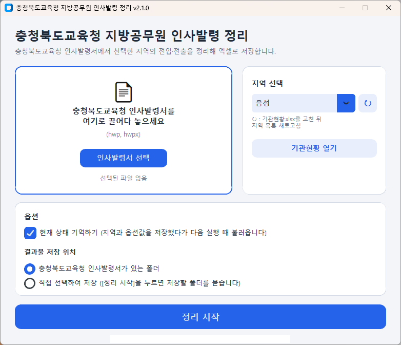

# 📋 인사발령 정리

### 👉 [📥 다운로드 및 실행 방법](docs/실행방법.md)

충청북도교육청 인사발령서(한글 파일)에서 **선택한 지역의 전입·전출을 직급·직렬별로 자동 분류·정렬**하여 엑셀로 만들어 주는 Windows용 프로그램입니다.
복잡한 설정 없이, 인사발령서를 창 위로 끌어다 놓고 **[정리 시작]** 만 누르면 됩니다.

> 현재 버전: **1.8.0**



---

## 📖 간단 사용법

1. `cb_personnel_appointment.exe`와 `기관현황.xlsx`를 **같은 폴더**에 둡니다.
2. 프로그램을 실행하고 인사발령서(`.hwp`, `.hwpx`)를 창 위로 끌어다 놓거나 **인사발령서 선택** 버튼을 누릅니다.
3. 오른쪽에서 **지역**을 고릅니다.
4. **정리 시작** 버튼을 누르면 잠시 후 결과 엑셀 파일이 자동으로 열립니다.
5. 원본 인사발령서는 바뀌지 않고, 항상 **새 엑셀 파일**로 저장됩니다.

### 결과 파일
- 파일 이름: `YYYY. M. D. 인사발령 전의 기초.xlsx`
- 시트 이름: `전의`
- 같은 이름의 파일이 있으면 덮어쓸지 물어봅니다.

### 자주 쓰는 팁
- **기관현황.xlsx를 고쳤을 때**: 지역 선택 옆의 **↻** 버튼으로 지역 목록을 새로고침합니다.
- **기관현황.xlsx를 바로 열고 싶을 때**: **기관현황 열기** 버튼을 누릅니다.
- **매번 같은 설정을 쓰고 싶을 때**: **현재 상태 기억하기**를 체크하면 지역과 저장 옵션이 다음 실행 때 그대로 불러와집니다.

---

## ⚠️ 알아두실 점

- 한글 파일을 읽는 동안 **한글 창이 잠시 열립니다.** 이때 프로그램이 접근 허용 팝업을 자동으로 처리(Alt+N 키 입력)하므로, **처리가 끝날 때까지 키보드·마우스를 조작하지 마세요.**
- 결과 엑셀이 **이미 열려 있으면 저장할 수 없습니다.** 엑셀을 닫고 다시 실행해 주세요.
- 필수실무요원, 전문관 면함, 겸임 발령은 정리 대상에서 **제외**됩니다.
- 인사발령서의 문구 형식에 따라 분류가 달라질 수 있으니, **결과는 반드시 원본 발령서와 대조**해 주세요.

---

## ✨ 주요 기능

### 1. 📄 인사발령서 불러오기
- `.hwp`, `.hwpx` 파일을 창 어디에나 **끌어다 놓기(드래그 앤 드롭)** 가능
- **인사발령서 선택** 버튼으로 파일 찾아서 열기

### 2. 🗺 지역별 정리
- `기관현황.xlsx`에 적힌 지역 중에서 선택
- 해당 지역의 기관(학교)·부서 **직제순**을 기준으로 전입·전출 판정 및 정렬

### 3. 🗂 자동 분류

| 구분 | 내용 |
|---|---|
| 발령 구분 | 승진 · 전보 · 전입 · 전출 · 휴직 · 복직 · 파견 · 파견복귀 · 신규임용 · 전문관지정 · 퇴직 |
| 1그룹 | 행정 · 전산 · 사서 · 공업 · 보건 · 식품위생 · 시설 |
| 2그룹 | 조리 · 시설관리 · 운전 · 사무운영 |
| 기타 | 기록연구사 · 임기제 |
| 급수 | 5급 이상 / 6급 / 7급 이하 |

- 정렬 순서: **직급 → 직렬 → 발령 구분 → 부서(직제순) → 성명**
- 전입자·전출자가 모두 없는 그룹은 결과에서 자동으로 빠집니다. (한쪽만 없으면 `해당 없음`으로 표시)

### 4. 🖨 인쇄까지 고려한 엑셀 결과물
- 전입(왼쪽)·전출(오른쪽)을 나란히 표시
- A4 가로, 너비 한 쪽 맞춤, 제목 행 반복 인쇄
- 그룹 크기에 맞춰 **쪽 나누기 자동 설정**

### 5. 💾 저장 위치 선택
- 인사발령서가 있는 폴더에 저장
- 또는 **지정한 폴더**에 저장

### 공통 기능
- 프로그램 실행 시 **새 버전을 자동 확인**하여 업데이트 안내 (인터넷이 막혀 있으면 조용히 넘어갑니다)
- 오류가 나면 원인을 알려주는 안내창 표시

---

## 📑 기관현황.xlsx 작성 방법

첫 번째 시트(또는 이름이 `기관현황`인 시트)를 사용합니다. **1행은 제목 줄**이며, **2행부터** 입력합니다. 모두 **직제순**으로 적어 주세요.

| A열 | B열 | C열 |
|---|---|---|
| 지역명 | 부서명 | 기관(학교)명 |

- 지역명이 빈 줄은 바로 위 지역을 이어받습니다. (병합 셀도 가능)
- 지역을 추가·수정했다면 프로그램에서 **↻** 버튼을 눌러 새로고침하세요.

---

## 💻 사용 환경

- **Windows 10 / 11** (64비트)
- **한컴오피스 한글**이 PC에 설치되어 있어야 합니다. (인사발령서를 읽을 때 사용)
- 엑셀 프로그램이 없어도 결과 파일은 만들어지지만, 결과를 열어 보려면 엑셀(또는 호환 프로그램)이 필요합니다.

### 폴더 구성 예시

```
인사발령정리/
├─ cb_personnel_appointment.exe   (프로그램)
├─ 기관현황.xlsx                (직접 작성)
└─ config.json        (상태 기억을 켰을 때 자동 생성)
```

---

## 🛠 소스 코드로 실행하기 (개발자용)

```bash
pip install pandas openpyxl customtkinter tkinterdnd2 pywin32
python cb_personnel_appointment.py
```

### exe 파일 만들기

```bash
pip install pyinstaller
pyinstaller --onefile --noconsole --collect-all tkinterdnd2 --collect-all customtkinter cb_personnel_appointment.py
```

완성된 `cb_personnel_appointment.exe`는 `dist` 폴더에 생깁니다.

### 업데이트 확인 설정

프로그램은 아래 주소의 `version.json`을 읽어 새 버전을 확인합니다.

```
https://raw.githubusercontent.com/tworemind-cpu/cb_personnel_appointment/main/version.json
```

```json
{
  "version": "2.1.0",
  "download_url": "https://github.com/tworemind-cpu/xb_)cb_personnel_appointment/releases/latest",
  "notes": "충청북도교육청 전용 프로그램임을 명시"
}
```

새 버전을 낼 때는 ① 코드의 `current_version` 수정 → ② exe 새로 빌드 후 업로드 → ③ `version.json` 수정 순서로 진행합니다.

---

## 📝 버전 이력

전체 버전 이력은 **[이력.md](docs/이력.md)** 에서 확인하실 수 있습니다.

---

## 🙋 문의 및 오류 제보

사용 중 불편한 점이나 오류가 있다면 [Issues](../../issues) 에 남겨 주세요.
오류 메시지 화면과 어떤 작업을 하던 중이었는지 함께 적어 주시면 큰 도움이 됩니다.
(개인정보가 담긴 인사발령서 원본은 올리지 마세요.)

---

## 📜 사용한 오픈소스

| 라이브러리 | 라이선스 |
|---|---|
| [pandas](https://pandas.pydata.org/) | BSD-3-Clause |
| [openpyxl](https://openpyxl.readthedocs.io/) | MIT |
| [CustomTkinter](https://github.com/TomSchimansky/CustomTkinter) | MIT |
| [tkinterdnd2](https://github.com/Eliav2/tkinterdnd2) | MIT |
| [pywin32](https://github.com/mhammond/pywin32) | PSF |
